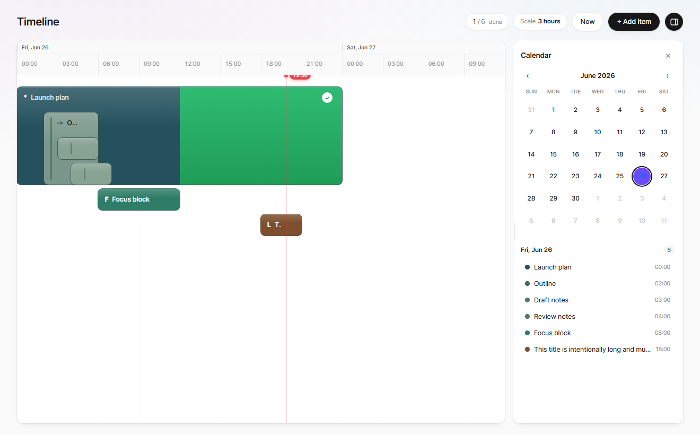

# Timeline

A fast, beautiful, single-day **timeline planner** for time-boxing your work. Drag, resize, nest, and complete tasks directly on an hour-scaled track — all in the browser, with zero backend.


Built with SvelteKit 2 + Svelte 5 (runes), TypeScript, and a Vercel-inspired design system. State persists to `localStorage`, so your plan survives refreshes without any account or server.

---

## Features

- **Time-boxed bars** — every task is a duration bar with a start and end time, positioned on a real clock axis. The default view spans ~36 hours so you always see today plus context.
- **Continuous zoom that resizes the gantt** — `Ctrl/⌘ + wheel` zooms in/out around the cursor, growing or shrinking the bars. Tick density adapts automatically (1h when zoomed in, widening to 2h / 3h / 6h / 12h as you zoom out) so labels never overlap.
- **Smart scrolling** — vertical wheel scrolls the rows when they overflow; otherwise it pans through time. `Shift + wheel` and trackpad swipes pan horizontally. The clock header stays pinned while rows scroll.
- **Live "now" line** — a red indicator with a time flag marks the current moment, is visible on load, and follows the clock. The **Now** button re-centres the view on the present.
- **Drag, resize, snap** — drag a bar to move it, drag its right edge to resize. Everything snaps to one-hour boundaries at any zoom level.
- **Unlimited nesting** — drop one task onto another to make it a child. **Parent bars grow vertically to contain their descendants**, forming clear visual groups. Self-drops and descendant-drops are rejected.
- **Resizable calendar sidebar** — a toggleable side panel (next to *Add item*) with a month **heat-map calendar**: each day is a circle whose fill deepens with how busy it is (scaled to the busiest day that month). Click a day to jump there; the panel also lists that day's items. Drag its edge to resize.
- **Partial completion** — mark a task complete "from now"; the segment from the current time to the task's end fills with a green progress overlay, clamped to the task's range.
- **Shared add / edit bubble** — one popover handles both creating and editing, with a title field, emoji icon picker, color swatches + custom color, and start/end hours.
- **Keyboard friendly** — `N` to add, `Enter` to save, `Esc` to close. Single-popover discipline with outside-click-to-close.
- **Premium, animated UI** — stacked-shadow elevation, hover micro-interactions, spring pop on menus, smooth drag-follow — all gated behind `prefers-reduced-motion`.
- **Pretendard everywhere** — the entire UI, including numeric and clock labels, is unified on **Pretendard Variable** with tabular figures.




---

## Tech stack

| Area | Choice |
|---|---|
| Framework | SvelteKit 2 + Svelte 5 (runes: `$state`, `$derived`, `$effect`) |
| Language | TypeScript (strict) |
| Build / dev | Vite 8 |
| Runtime / PM | Bun |
| Unit tests | Vitest |
| E2E tests | Playwright (Chromium) |
| Styling | Hand-authored CSS with a token-based design system (no Tailwind, no UI kit) |
| Persistence | `localStorage` (`timeline.todo.v1`) |

There is **no React and no Tailwind** anywhere in the dependency tree — both are deliberate exclusions.

---

## Getting started

```sh
# install dependencies
bun install

# start the dev server (http://localhost:5173)
bun run dev

# production build + preview
bun run build
bun run preview
```

### Testing

```sh
bun run check        # svelte-check (types + a11y)
bun run test:unit    # Vitest unit tests (timeline model math)
bun run test:e2e     # Playwright e2e (builds + previews automatically)
bun run test         # unit + e2e
```

---

## Usage

| Action | How |
|---|---|
| Add a task | Click empty track space, press `+ Add item`, or press `N` |
| Edit a task | Click the bar |
| Move a task | Drag the bar body (snaps to the hour) |
| Resize a task | Drag the right edge |
| Nest a task | Drag it onto another task's header row |
| Un-nest a task | Drag it onto empty track space |
| Complete from now | Click the check button inside a bar |
| Pan through time | `Shift + wheel`, trackpad swipe, or drag empty space |
| Scroll rows | Vertical wheel (when rows overflow) |
| Zoom in / out | `Ctrl/⌘ + wheel` (resizes the bars, ticks adapt) |
| Jump to current time | `Now` button |
| Open / close sidebar | Panel button next to *Add item* |
| Resize sidebar | Drag the sidebar's left edge |
| Jump to a date | Click a day in the calendar |
| Close the editor | `Esc`, the `×`, or click outside |


---

## Architecture

```
src/
├─ app.css                       # design tokens (color, type, spacing, shadow, motion) + base
├─ app.html                      # font link (Pretendard Variable)
├─ routes/
│  ├─ +layout.svelte             # imports global CSS
│  └─ +page.svelte               # the timeline app: state, drag/drop, zoom, scroll, persistence, editor, sidebar
└─ lib/timeline/
   ├─ model.ts                   # pure timeline domain logic (no DOM)
   ├─ model.spec.ts              # Vitest unit tests for the model
   ├─ TimelineItemBar.svelte     # a single draggable/resizable task bar
   ├─ TimelineNowLine.svelte     # the live current-time indicator
   ├─ TimelineCalendar.svelte    # month heat-map calendar in the sidebar
   └─ IconPicker.svelte          # emoji icon picker
```

### Design principles

- **Parse, don't validate.** `makeItem()` returns a discriminated result (`valid` | `invalid_duration`); invalid durations can never enter state.
- **Pure model, dumb DOM.** All time math (tick generation, snapping, positioning, row spans, nesting depth, completion clamping, reparent validation) lives in `model.ts` and is unit-tested without a browser.
- **One row, one task.** Each task occupies its own row; parents expand vertically to span their subtree. This keeps hit-testing unambiguous while still rendering nested containers.

A deep, unit-by-unit account of how this was built — every bug, root cause, and decision — lives in **[DEVELOPMENT.md](DEVELOPMENT.md)**.

---

## License

MIT
