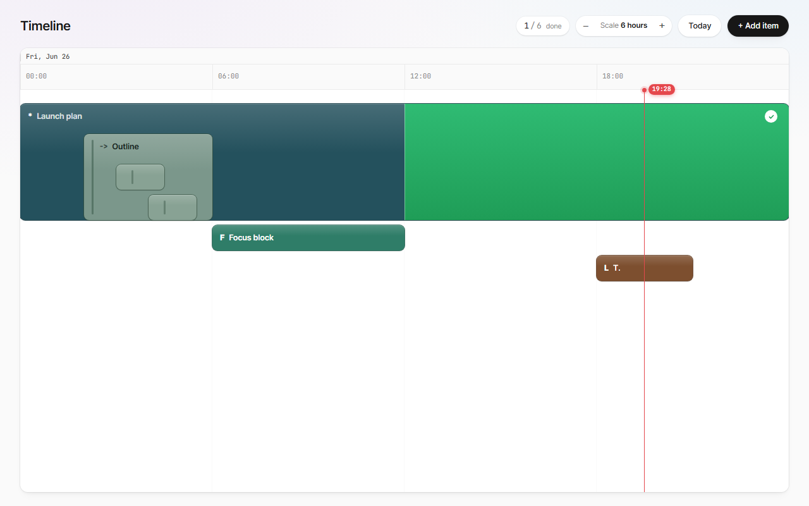
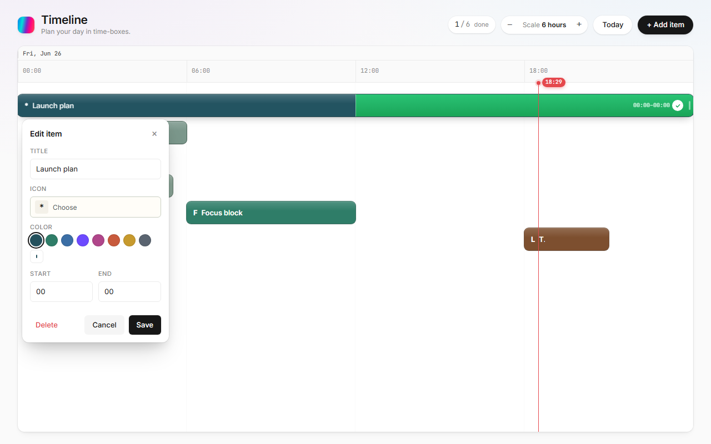
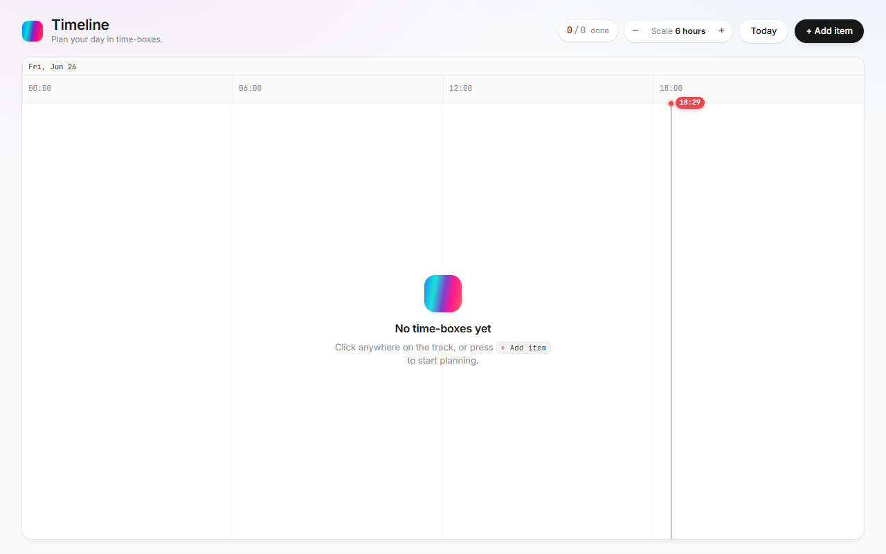

# Timeline

A fast, beautiful, single-day **timeline planner** for time-boxing your work. Drag, resize, nest, and complete tasks directly on an hour-scaled track — all in the browser, with zero backend.



Built with SvelteKit 2 + Svelte 5 (runes), TypeScript, and a Vercel-inspired design system. State persists to `localStorage`, so your plan survives refreshes without any account or server.

---

## Features

- **Time-boxed bars** — every task is a duration bar with a start and end time, positioned on a real clock axis (00:00 / 06:00 / 12:00 / 18:00 by default).
- **Wheel / trackpad scrolling** — scroll horizontally to pan through time. `Ctrl/⌘ + wheel` zooms between 6h, 3h, and 1h tick scales.
- **Drag, resize, snap** — drag a bar to move it, drag its right edge to resize. Everything snaps to one-hour boundaries even at the six-hour scale.
- **Unlimited nesting** — drop one task onto another to make it a child. **Parent bars grow vertically to contain their descendants**, forming clear visual groups. Self-drops and descendant-drops are rejected.
- **Partial completion** — mark a task complete "from now"; the segment from the current time to the task's end fills with a green progress overlay, clamped to the task's range.
- **Shared add / edit bubble** — one popover handles both creating and editing, with a title field, emoji icon picker, color swatches + custom color, and start/end hours.
- **Live "now" line** — a red indicator with a time flag tracks the current moment across the track.
- **Keyboard friendly** — `N` to add, `Enter` to save, `Esc` to close. Single-popover discipline with outside-click-to-close.
- **Premium, animated UI** — stacked-shadow elevation, hover micro-interactions, spring pop on menus, smooth drag-follow — all gated behind `prefers-reduced-motion`.
- **Korean-first typography** — UI text renders in **Pretendard Variable**; numeric/clock labels use JetBrains Mono.



---

## Tech stack

| Area | Choice |
|---|---|
| Framework | SvelteKit 2 + Svelte 5 (runes: `$state`, `$derived`, `$effect`) |
| Language | TypeScript (strict) |
| Build / dev | Vite 8 |
| Runtime / PM | Bun |
| Unit tests | Vitest |
| E2E tests | Playwright (Chromium) |
| Styling | Hand-authored CSS with a token-based design system (no Tailwind, no UI kit) |
| Persistence | `localStorage` (`timeline.todo.v1`) |

There is **no React and no Tailwind** anywhere in the dependency tree — both are deliberate exclusions.

---

## Getting started

```sh
# install dependencies
bun install

# start the dev server (http://localhost:5173)
bun run dev

# production build + preview
bun run build
bun run preview
```

### Testing

```sh
bun run check        # svelte-check (types + a11y)
bun run test:unit    # Vitest unit tests (timeline model math)
bun run test:e2e     # Playwright e2e (builds + previews automatically)
bun run test         # unit + e2e
```

---

## Usage

| Action | How |
|---|---|
| Add a task | Click empty track space, press `+ Add item`, or press `N` |
| Edit a task | Click the bar |
| Move a task | Drag the bar body (snaps to the hour) |
| Resize a task | Drag the right edge |
| Nest a task | Drag it onto another task's header row |
| Un-nest a task | Drag it onto empty track space |
| Complete from now | Click the check button inside a bar |
| Pan through time | Scroll the wheel / swipe the trackpad, or drag empty space |
| Zoom | `Ctrl/⌘ + wheel`, or the `−` / `+` buttons |
| Jump to today | `Today` button |
| Close the editor | `Esc`, the `×`, or click outside |



---

## Architecture

```
src/
├─ app.css                       # design tokens (color, type, spacing, shadow, motion) + base
├─ app.html                      # font links (Pretendard Variable, JetBrains Mono)
├─ routes/
│  ├─ +layout.svelte             # imports global CSS
│  └─ +page.svelte               # the timeline app: state, drag/drop, zoom, persistence, editor
└─ lib/timeline/
   ├─ model.ts                   # pure timeline domain logic (no DOM)
   ├─ model.spec.ts              # Vitest unit tests for the model
   ├─ TimelineItemBar.svelte     # a single draggable/resizable task bar
   ├─ TimelineNowLine.svelte     # the live current-time indicator
   └─ IconPicker.svelte          # emoji icon picker
```

### Design principles

- **Parse, don't validate.** `makeItem()` returns a discriminated result (`valid` | `invalid_duration`); invalid durations can never enter state.
- **Pure model, dumb DOM.** All time math (tick generation, snapping, positioning, row spans, nesting depth, completion clamping, reparent validation) lives in `model.ts` and is unit-tested without a browser.
- **One row, one task.** Each task occupies its own row; parents expand vertically to span their subtree. This keeps hit-testing unambiguous while still rendering nested containers.

A deep, unit-by-unit account of how this was built — every bug, root cause, and decision — lives in **[DEVELOPMENT.md](DEVELOPMENT.md)**.

---

## License

MIT
